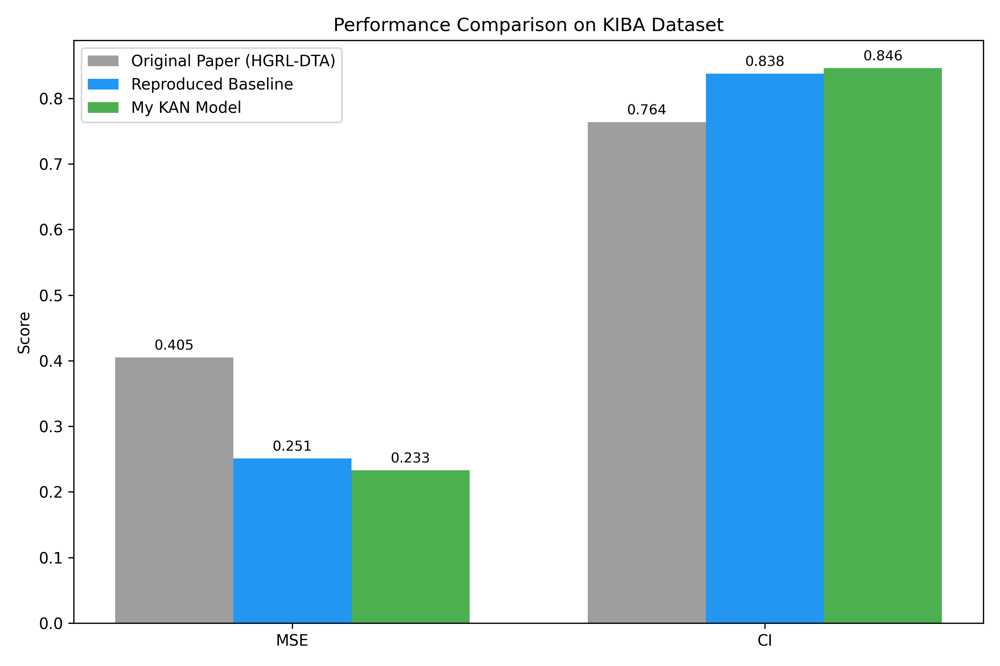

# KAN for Drug-Target Affinity Prediction (DTANet+)

Independent side project on Drug-Target Affinity (DTA) prediction. This work builds upon the **DTANet+** framework and investigates the effectiveness of **Kolmogorov–Arnold Networks (KAN)** as an alternative to conventional neural network backbones.

## My Contributions
- Implemented Kolmogorov–Arnold Networks (KAN) for DTA prediction
- Processed the KIBA dataset and conducted hyperparameter tuning
- Designed and conducted a controlled 2×2 ablation study (5k vs. full data; KAN vs. baseline)
- Achieved consistent improvement over the reproduced baseline under identical settings

## Methods
- **KAN design**: Replaces fixed activation functions at nodes with learnable univariate basis functions on network edges, offering greater flexibility and interpretability for complex nonlinear interactions.
- **Dataset**: KIBA dataset
- **Evaluation Metrics**: Mean Squared Error (MSE), Concordance Index (CI)
- **Environment**: Python, PyTorch, Mac M4 Air (MPS acceleration)

## Results

### 2×2 Ablation Study on KIBA

| Data Size | Model | CI | MSE |
|-----------|-------|-----|-----|
| 5k | Baseline | 0.8105 | 0.3169 |
| 5k | KAN | **0.8239** | **0.2911** |
| Full | Baseline | 0.8379 | 0.2512 |
| Full | **KAN** | **0.8462** | **0.2327** |



The KAN-augmented model consistently outperformed the reproduced baseline under identical random-split settings, achieving improved CI (+0.0083 to +0.0134) and lower MSE.

## Note on Evaluation Protocol
The original DTANet+ paper reports results under a **cold-start** setting (unseen drugs/targets in the test set). Due to hardware constraints (Mac M4 Air, 16GB memory), this study adopted a **random split** for evaluation, which is a more permissive setting. Therefore, absolute performance metrics are **not directly comparable** to the original paper. The core contribution of this work is the controlled 2×2 ablation study, which demonstrates the effectiveness of the KAN module under a consistent, reproducible setting.

## References
1. DTANet+: [Insert the actual title/authors of the DTANet+ paper here]
2. KAN: Kolmogorov–Arnold Networks
3. Code for data processing and benchmark evaluation is available in this repository. The KIBA dataset can be downloaded from [insert source].

## How to Run
```bash
pip install -r requirements.txt
python train_kiba.py kan-dta-prediction
Independent side project implementing Kolmogorov–Arnold Networks (KAN) for drug-target affinity (DTA) prediction, benchmarked on  KIBA datasets against the HGRL-DTA baseline. Python/PyTorch.
